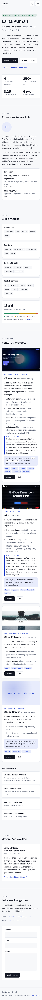
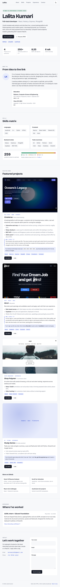
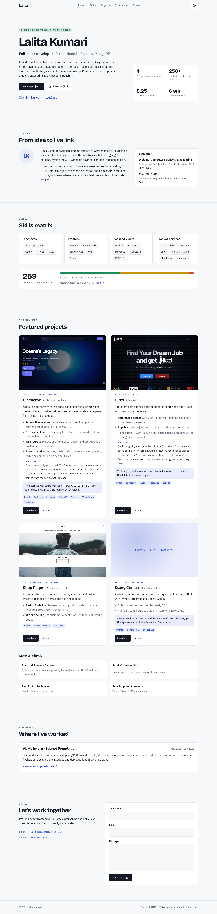

# Lalita Kumari · Portfolio

A responsive personal portfolio: hero, About, Skills matrix, Featured projects, Experience and a Contact form. Built with semantic HTML5, modern CSS (custom properties, Flexbox, Grid) and vanilla JavaScript. No build step.

**Live:** _add the deployment link here_

## Features

- Semantic landmarks (`header`, `nav`, `main`, `section`, `article`, `footer`), a skip link, and labelled sections
- Mobile-first layout with breakpoints at 768px (tablet) and 1024px (desktop)
- Mobile navigation drawer with an animated hamburger → X toggle; closes on Escape, backdrop click or link pick, and traps focus while open
- Dark / light theme toggle that follows the OS until you choose, and remembers the choice
- Smooth scrolling to sections, with the active section highlighted in the nav
- Scroll-reveal and hover animations, switched off for `prefers-reduced-motion`
- Contact form with inline, accessible validation; it opens the visitor's email app with the message filled in, so no backend is needed

## Structure

```
index.html
css/
  base.css        design tokens (light + dark), reset, typography
  layout.css      container, sections, page grids per breakpoint
  nav.css         sticky header, theme toggle, mobile drawer
  components.css  buttons, cards, chips, project cards, form
  animations.css  entrance / reveal animations, reduced motion
js/
  theme-init.js   sets the theme before first paint (no flash)
  theme.js        theme toggle
  nav.js          drawer + active-section highlighting
  reveal.js       scroll reveal
  contact.js      form validation + mailto hand-off
assets/           screenshots, resume PDF, favicon
screenshots/      responsive proof at 375 / 768 / 1280px
```

## Run locally

```bash
python3 -m http.server 8000   # then open http://localhost:8000
```

## Responsive screenshots

| Mobile (375px) | Tablet (768px) | Desktop (1280px) |
| --- | --- | --- |
|  |  |  |

Mobile menu open: [`screenshots/mobile-375-menu-open.png`](screenshots/mobile-375-menu-open.png). Dark theme versions are alongside each.

## Acceptance checks

Verified in Chromium at 375, 768, 1280 and 1440px, in both themes:

- `document.documentElement.scrollWidth === clientWidth` at every width, with no element extending past the viewport, so there is no horizontal scrollbar
- All visible text meets WCAG AA contrast (4.5:1 for body text, 3:1 for large text) in light and dark
- Nav and drawer links jump smoothly to their section, offset for the sticky header
